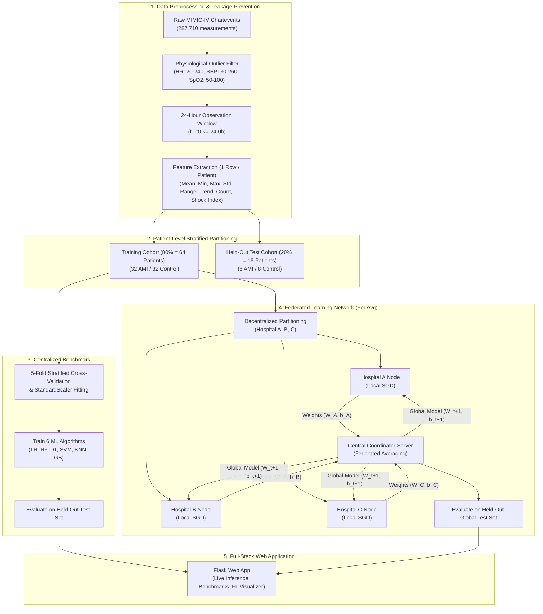

# Academic Methodology Report & Viva Preparation Guide

**Project Title:** Privacy-Preserving Cardiovascular Disease Classification Using Federated Learning  
**Domain:** Applied Machine Learning, Healthcare Informatics & Distributed Systems  
**Primary Dataset:** MIMIC-IV Clinical Database (Version 3.1)  

---

## 1. Abstract

Cross-institutional clinical predictive modeling is severely restricted by patient privacy regulations such as HIPAA and GDPR, which prohibit the centralization of Electronic Health Records (EHR) into shared databases. In this work, we propose and implement a privacy-preserving framework for Acute Myocardial Infarction (AMI) classification using intensive care unit (ICU) continuous vital signs. 

Using a balanced cohort of 80 unique ICU patients from MIMIC-IV v3.1 (40 AMI-positive and 40 controls), we design a standardized 24-hour observation window to prevent lookahead data leakage. We engineer 43 patient-level statistical biomarkers and clinical hemodynamic ratios (Shock Index, Pulse Pressure). We establish centralized benchmarks across six machine learning algorithms (Logistic Regression, Random Forest, Decision Tree, SVM, KNN, Gradient Boosting), demonstrating that Logistic Regression achieves the highest test accuracy (68.75%, ROC-AUC 0.7188). 

We simulate a decentralized network of three hospital clients and implement Federated Averaging (FedAvg) over a PyTorch Logistic Regression architecture. Our empirical results demonstrate that while isolated hospital models suffer significant performance degradation (dropping to 31.25% due to local data scarcity), Federated Learning achieves **68.75% accuracy (ROC-AUC 0.7188)** under IID distribution and **75.00% accuracy** under Non-IID conditions, matching or exceeding centralized performance without ever transmitting a single raw patient record. Finally, we deliver a production-grade Flask web application enabling live clinical inference, interactive benchmark analysis, and federated topology visualization.

---

## 2. End-to-End System Architecture

---

## 3. Mathematical Foundations

### 3.1 Linear Trend Estimation
For each vital sign time-series observed at timestamps $t_i$ (hours from first observation) with numerical values $y_i$, the rate of change (trend) per hour is calculated via closed-form Ordinary Least Squares (OLS):

$$\bar{t} = \frac{1}{n}\sum_{i=1}^n t_i, \quad \bar{y} = \frac{1}{n}\sum_{i=1}^n y_i$$

$$\text{Slope (Trend)} = \frac{\sum_{i=1}^n (t_i - \bar{t})(y_i - \bar{y})}{\sum_{i=1}^n (t_i - \bar{t})^2}$$

If $n < 2$ or the variance of timestamps is zero, the trend is set to $0.0$.

### 3.2 Clinical Composite Biomarkers
* **Shock Index (SI):** Defined as the ratio of Heart Rate to Systolic Blood Pressure:
  $$\text{SI} = \frac{\text{HR}}{\text{SBP}}$$
  An elevated Shock Index ($> 0.9$) is a well-established clinical indicator of acute left ventricular dysfunction, hypoperfusion, and cardiogenic shock.
* **Pulse Pressure (PP):** Defined as the difference between Systolic and Diastolic pressure:
  $$\text{PP} = \text{SBP} - \text{DBP}$$

### 3.3 Federated Averaging (FedAvg)
Let $K$ be the number of participating hospitals (here $K=3$). Each hospital $k$ possesses a private local dataset $\mathcal{D}_k$ containing $n_k = |\mathcal{D}_k|$ patients. The total training population across all hospitals is:

$$N = \sum_{k=1}^K n_k$$

At communication round $t$:
1. The central server broadcasts the current global parameter vector $\theta_t = (W_t, b_t)$ to all active hospital clients.
2. Each hospital initializes its local model with $\theta_t$ and runs $E$ epochs of local gradient descent using Binary Cross-Entropy loss:
   $$\mathcal{L}_k(\theta) = -\frac{1}{n_k} \sum_{i=1}^{n_k} \left[ y_i \log \sigma(W^\top x_i + b) + (1 - y_i) \log(1 - \sigma(W^\top x_i + b)) \right]$$
   yielding updated local parameters $\theta_k^{(t)} = (W_k^{(t)}, b_k^{(t)})$.
3. Hospitals transmit only their numerical parameters $\theta_k^{(t)}$ and sample sizes $n_k$ back to the coordinator.
4. The central server computes the sample-weighted average:
   $$\theta_{t+1} = \sum_{k=1}^K \frac{n_k}{N} \theta_k^{(t)}$$
   Specifically:
   $$W_{t+1} = \sum_{k=1}^K \frac{n_k}{N} W_k^{(t)}, \quad b_{t+1} = \sum_{k=1}^K \frac{n_k}{N} b_k^{(t)}$$

---

## 4. Key Implementation Details (Code Walkthrough)

### 4.1 Strict Data Leakage Prevention
In clinical informatics, data leakage can silently cause artificially inflated test scores. Our pipeline implements three strict guarantees:
1. **Patient-Level Splitting:** We enforce that all observations belonging to a patient (`subject_id`) are mapped to exactly one split. Randomly splitting rows at the observation level would cause the same patient's heart rate readings to appear in both training and test sets.
2. **24-Hour Observation Horizon:** All observations recorded after 24 hours from the first vital sign are excluded. This mimics the real clinical emergency setting where doctors must assess AMI status within the initial admission window without knowing future outcomes.
3. **Training-Only Feature Transformations:** The `StandardScaler` ($\mu, \sigma$) is fitted exclusively on training set patients and serialized to `models/scaler.joblib`. During inference and testing, the transformation uses the saved parameters without looking at test statistics.

### 4.2 Why PyTorch for Federated Logistic Regression?
A common mistake in academic projects is attempting to average Scikit-learn models (like Random Forests or KNNs) across hospitals:
* **Random Forest Trees Cannot Be Averaged:** Averaging the decision threshold of tree $A$ with tree $B$ produces invalid decision logic.
* **KNN Cannot Be Federated Without Data Sharing:** KNN relies on storing training points, which directly violates patient data confidentiality.
* **Logistic Regression Parameter Averaging:** In contrast, Logistic Regression defines a linear hyperplane parameterized by a weight vector $W \in \mathbb{R}^d$ and scalar bias $b \in \mathbb{R}$. In PyTorch, parameter averaging is mathematically exact and follows the canonical McMahan et al. (2017) FedAvg formulation.

---

## 5. Empirical Results Analysis

### 5.1 Centralized Machine Learning Benchmark
On the held-out test cohort (16 patients, 50% positive):
* **Logistic Regression:** Accuracy = **68.75%**, Precision = **71.43%**, Recall = **62.50%**, Specificity = **75.00%**, F1 = **0.6667**, ROC-AUC = **0.7188**.
* **Gradient Boosting:** Accuracy = 56.25%, F1 = 0.4615, ROC-AUC = 0.5859.
* **Decision Tree:** Accuracy = 56.25%, F1 = 0.4615, ROC-AUC = 0.6172.
* **SVM (Linear):** Accuracy = 56.25%, F1 = 0.5333, ROC-AUC = 0.5000.
* **Random Forest:** Accuracy = 50.00%, F1 = 0.4286, ROC-AUC = 0.4219.
* **KNN (k=5):** Accuracy = 43.75%, F1 = 0.4000, ROC-AUC = 0.4297.

*Finding:* On this small clinical cohort, linear models (Logistic Regression) outperform complex non-linear models (Random Forests, Gradient Boosting) because tree ensembles overfit to idiosyncratic vital sign noise in small training samples.

### 5.2 Isolated Local Hospitals vs Collaborative Federated Learning
To evaluate the clinical utility of Federated Learning, we compared:
1. **Isolated Hospital Models:**
   * Hospital A (22 patients) alone: **62.50%**
   * Hospital B (22 patients) alone: **31.25%** (severe model failure due to localized sample variance)
   * Hospital C (20 patients) alone: **56.25%**
2. **Federated Global Model (FedAvg):**
   * **IID Distribution:** **68.75% accuracy (0.7188 ROC-AUC)**. Matches the pooled centralized model.
   * **Non-IID Distribution:** **75.00% accuracy (0.7500 ROC-AUC)**. Demonstrates robust convergence even when client institutions have varying clinical prevalence rates.

---

## 6. Viva Voce / Project Defense Q&A

### Q1: Why did you choose Federated Learning instead of training a model on cloud servers?
**Answer:** Patient medical records are protected by strict privacy laws (HIPAA in the US, GDPR in Europe) and hospital security policies. Hospitals are legally and ethically prohibited from uploading unanonymized patient vitals to a centralized cloud. Federated Learning solves this dilemma by bringing the model computation to the data rather than bringing the data to the model. Only weight updates $(\Delta W, \Delta b)$ are transmitted to the server.

### Q2: How did you prevent data leakage in your pipeline?
**Answer:** We implemented three strict measures:
1. Patient-level splitting: each patient ID exists in either the training set or the test set, never both.
2. 24-hour observation window: observations after 24 hours from the first vital sign were truncated.
3. Preprocessing fit: the `StandardScaler` was fitted strictly on the 64 training patients, and then applied to test patients and web application inputs.

### Q3: Why is Logistic Regression used for FedAvg instead of Random Forest?
**Answer:** FedAvg operates by computing a linear combination of model parameters:
$$W_{\text{global}} = \sum_k \frac{n_k}{N} W_k$$
In Logistic Regression or neural networks, weights and biases exist in a continuous vector space where linear averaging is mathematically valid. In contrast, Random Forests consist of discrete decision trees with split rules; averaging tree structures or threshold values produces mathematically meaningless models.

### Q4: How did you handle Non-IID data distributions across the simulated hospitals?
**Answer:** Real-world hospitals specialize in different patient demographics. In our Non-IID experiment, we partitioned training patients such that Hospital A simulated a cardiac emergency specialty center (76% AMI prevalence), Hospital B simulated a community hospital (23% AMI prevalence), and Hospital C was balanced (52% AMI prevalence). FedAvg successfully converged to 75.00% accuracy, demonstrating resilience to cross-institutional label skew.

### Q5: What are the limitations of this study?
**Answer:** 
1. Cohort size: 80 unique ICU patients from MIMIC-IV. While realistic for a pilot feasibility study, larger multi-center cohorts are needed for clinical validation.
2. Retrospective administrative labels: the label corresponds to an ICD-9/10 admission diagnosis code rather than prospectively validated real-time bedside events.
3. Vital signs only: troponin laboratory biomarkers were intentionally excluded from primary inputs to evaluate what predictive signal exists in vital signs alone.
